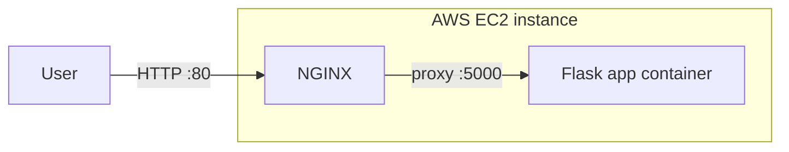
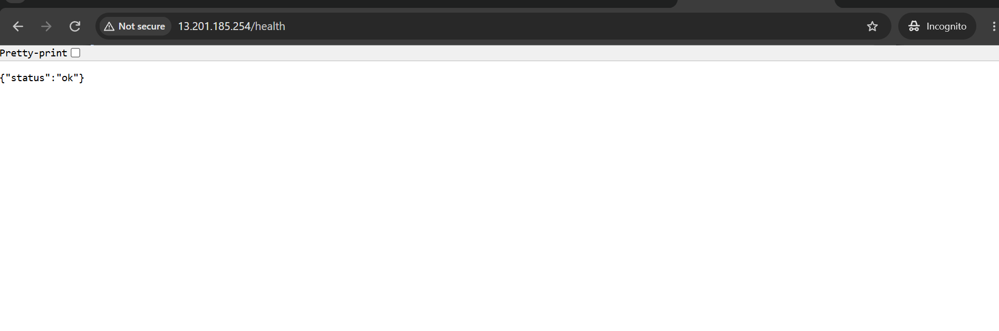
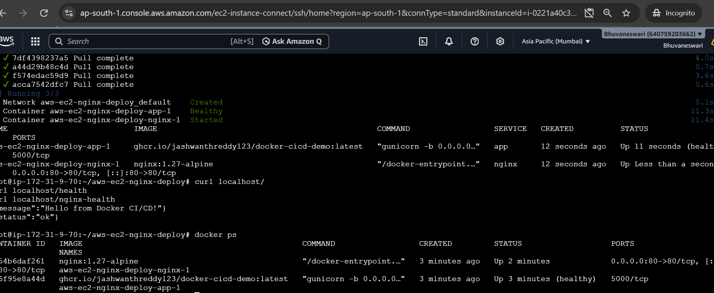

# aws-ec2-nginx-deploy

**Goal:** Deploy a containerized Flask app on AWS EC2 behind an NGINX reverse proxy, using Docker Compose with health checks.

## Tools used

- AWS EC2 (Ubuntu, free tier)
- Docker and Docker Compose
- NGINX (reverse proxy)
- Flask app image from [docker-cicd-demo](https://github.com/jashwanthreddy123/docker-cicd-demo), published on GHCR

## Architecture



## Setup

1. Launch an Ubuntu EC2 instance. Security group: SSH (22) from your IP only, HTTP (80) from anywhere.
2. Install Docker:
   ```bash
   sudo apt update
   sudo apt install -y docker.io docker-compose-v2 git
   sudo usermod -aG docker $USER
   ```
3. Clone this repo and start the stack:
   ```bash
   git clone https://github.com/jashwanthreddy123/aws-ec2-nginx-deploy.git
   cd aws-ec2-nginx-deploy
   docker compose up -d
   ```
4. Verify:
   ```bash
   curl http://<EC2_PUBLIC_IP>/health
   ```

## Health checks

- The app container has a Docker health check against `/health`.
- NGINX only starts once the app reports healthy.
- `/nginx-health` confirms NGINX itself is serving.

## Screenshots




## Notes

- The app port is not published, only NGINX is exposed on port 80.
- Stop the instance when not in use to avoid charges.
